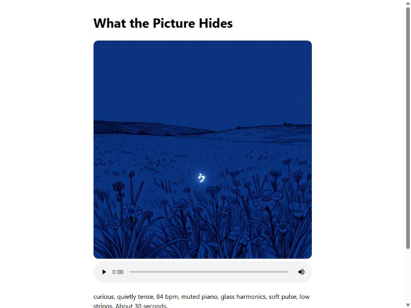

# Repo anthem

[](https://pollinations.ai/?ref=badge)

An [Agent Skill](https://agentskills.io) that has your coding agent write and produce a 30 second theme song and a cover for the repository it is working in, with Pollinations music and image models through the [polli CLI](https://www.npmjs.com/package/@pollinations/cli). Pollinations quest [#20020](https://github.com/pollinations/pollinations/issues/20020).



The page above is real output for [Stego Lab](https://github.com/tomdacatto/pollinations-stego-lab), in [`examples/stego-lab/anthem`](examples/stego-lab/anthem).

## What is different

Other creative skills take a one-line idea. This one starts from the repository, and **checks** that it did:

- The agent writes a short brief (mood, tempo, instruments, cover) with two to four **quotes**, each copied from a file of the repository with the file's path.
- `scripts/pack.mjs` then looks every quote up in the file it names. A quote that is not there fails the run with the exact reason, so the song cannot claim a reason the repository does not give.
- It also checks the files: the mp3 must really be an mp3 of 10 to 60 seconds, the picture must really be a png or jpeg (an image model can return a jpeg under a `.png` name, as it did in the example, and the check renames it), and only then it writes `anthem/index.html` with the cover, a player and the quotes.

## Install

Copy `skills/repo-anthem` into your agent's skills folder, for example `~/.claude/skills/repo-anthem` for Claude Code, then sign in once:

```bash
npm i -g @pollinations/cli
polli auth login
```

Then ask your agent: "write an anthem for this repo". The agent spends your own Pollen through your own login; nothing is stored in this repository.

## What it costs

Music is billed per second of output and the skill asks for 30 seconds. The real run for the example (one 30 s song with `elevenmusic`, one 1024x1024 cover with `zimage`) used 0.079 Pollen in all, read from the key's budget before and after.

## Checking it

```bash
npm test
node skills/repo-anthem/scripts/pack.mjs examples/stego-lab/anthem
```

The 8 tests cover the brief, the quote check (case and spacing ignored, paths outside the repository refused), mp3 length from the frame header and ID3 tag, png and jpeg detection, the rename, running the check twice, a bad folder that writes no page, and escaping in the page.

## Not verified

- I have not listened to the song. The check proves it is a 30 second mp3, not that it is good.
- The skill was run step by step by hand in a Claude Code session, with the same commands the skill gives. I did not load it as an installed skill in a fresh Claude Code or Codex session.
- The mp3 length is read from the first frame and the file size, which is exact for constant bitrate files (what the model returned); a variable bitrate file would be a close estimate.
- One repository and one run. Music and image models vary from run to run.

MIT licence.
